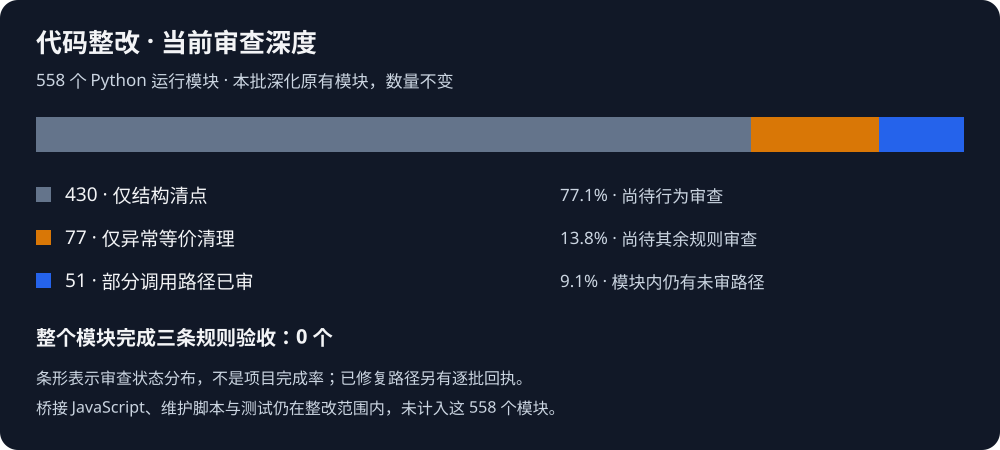

# 当前进度 · 2026-11-04

## 代码整改

| 当前深度 | 模块数 | 占当前清单 | 距离完成还缺什么 |
| --- | ---: | ---: | --- |
| 仅结构清点 | 430 | 77.1% | 逐调用检查三条要求、修改与定向验证 |
| 仅异常等价清理 | 77 | 13.8% | 重复校验、函数职责与既有防御授权审查 |
| 部分调用路径审查 | 51 | 9.1% | 同模块其余路径审查和相应验证 |
| 整模块三条验收完成 | 0 | 0% | 尚无完整模块验收记录 |

这不是项目完成率。前三项互斥合计558；第4项列出当前完整验收数量。数字从原module-inventory及逐批module-delta重新汇总，并与当前rouge/**/*.py清单比对：无新增或缺失路径。链路见coverage-audit.json。JS桥接、维护脚本和测试另在范围内，当前没有可核验的全量完成率。此次仅核对清单与既有记录，未运行全量检查。

## 产品进度

| 主线 | 当前状态 | 下一验收缺口 |
| --- | --- | --- |
| 功能节 | 472已完成；473在制 | 节数是历史交付编号，不是工作量或完成比例 |
| 地图叠加473 | 大窗口显示、类型选择、小卡和网页入口已有验收 | 快速光标漏跟、间歇节点名称点击穿透仍未关闭 |
| Gate 0 记录 | 工具已有；记录1场，完整录像配对0场 | 补完整正常流程对照、转场动画、缩放遮挡会话 |
| Gate 1 连续同步 | 部分链路已修，持续体验未验收完成 | 过载短页覆盖、真实更新时延、小窗口/缩放恢复 |
| Gate 2 入口收拢 | 常用入口已迁移，剩余入口待核 | 低频独立面板、跨屏/DPI与密集地图阅读 |
| Gate 3 视频效果 | 部分效果已有单项验收 | 其余功能、交互和外观逐项实机演示 |
| P1/P2/P3保留需求 | 均未全部完成 | 机制证据与校准、识别完整性、资料覆盖和视频功能缺口 |

产品状态复用当前PROJECT_PROGRESS.md、CLOUD_HANDOFF.md及DEVELOPMENT_CHECKPOINT.json；本批未重测地图交互或重算历史耗时。精确剩余范围继续以PROJECT_PROGRESS.md为准。当前工作是代码维护，不增加功能节。
